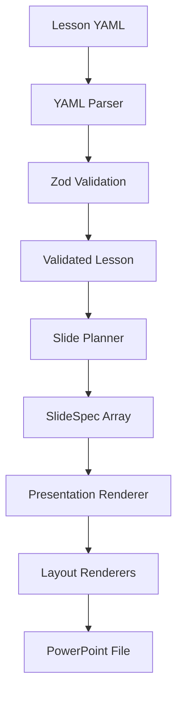

# Arabic Deck Builder

A local, structured PowerPoint generation system for teaching Arabic as a foreign language.

Arabic Deck Builder transforms teacher-authored lesson specifications into validated, structured PowerPoint presentations. The project combines software engineering with instructional design, allowing a teacher to describe the learning experience while the system handles repetitive presentation production.

The project is currently focused on Arabic instruction for non-native speakers, especially beginner learners, but its lesson model is designed to remain independent of a specific learner language. Translation support can therefore be Russian, English, or another language.

---

## Why I Built This Project

While teaching Arabic to foreign learners, I found that preparing high-quality lessons repeatedly required the same technical work:

- creating and formatting slides;
- maintaining visual consistency;
- duplicating question and answer states;
- progressively revealing content;
- placing Arabic and learner-language support correctly;
- creating repeated activity structures;
- adapting images to different slide layouts;
- building dialogues step by step;
- reducing learner support across repeated attempts.

The difficult part should be **instructional design**, not repetitive slide construction.

The project therefore separates two responsibilities:

> The teacher designs the learning experience.  
> The system handles deterministic presentation generation.

This distinction is especially important in language education because the order in which information appears can itself be part of the pedagogy.

For example, instead of immediately showing:

**هَذَا كِتَاب**

the system can first show:

**مَا هَذَا؟**

allow the learner to attempt an answer, and only then reveal the correct response.

A single instructional activity can therefore generate multiple presentation states automatically.

---

## Current Status

**Current stable release: `v0.2.0`**

**Current development milestone: `v0.3.0 — Teaching Activities`**

The core generation pipeline and image asset system are complete.

The current development version adds a larger pedagogical activity system, progressive learner support, long-dialogue segmentation, and structural lesson slides.

The main pipeline is:

```text
Lesson YAML
    ↓
YAML Parser
    ↓
Zod Validation
    ↓
Validated Lesson
    ↓
Slide Planner
    ↓
SlideSpec[]
    ↓
Presentation Renderer
    ↓
Layout Renderer
    ↓
PowerPoint (.pptx)
```

The teacher writes a structured lesson once. The planner decides how many presentation states are needed, and the renderer converts those states into PowerPoint slides.

---

## Implemented Features

### Lesson authoring

- human-readable lesson files using YAML;
- lesson metadata including level, title, goal, and translation language;
- runtime validation using Zod;
- TypeScript domain models;
- reusable activity schemas;
- deterministic activity-to-slide planning.

### Presentation generation

- PowerPoint generation using PptxGenJS;
- Arabic right-to-left rendering;
- centralized typography and color theme;
- independent layout renderers;
- structural lesson slides;
- progressive reveal states;
- reusable presentation pipeline.

### Image system

- logical image asset names;
- asset path resolution;
- missing-image errors;
- automatic image dimension inspection;
- aspect-ratio preservation;
- contain-style image fitting;
- portrait, balanced, and landscape classification;
- adaptive image placement.

### Translation support

Translation is not tied to Russian.

A lesson can declare:

```yaml
translation_language: ru
```

or:

```yaml
translation_language: en
```

Activity fields use the generic name:

```yaml
translation:
```

instead of language-specific property names.

---

## Teaching Activity System

The project currently supports thirteen core instructional activity types.

### 1. `introduce`

Introduces new language using Arabic, optional translation support, and an image.

```yaml
- type: introduce
  arabic: كِتَاب
  translation: книга
  image: book
```

---

### 2. `question_reveal`

Allows the learner to attempt an answer before seeing it.

```yaml
- type: question_reveal
  question: مَا هَذَا؟
  answer: هَذَا كِتَاب
  image: book
```

The planner expands one activity into:

```text
question
   ↓
learner attempt
   ↓
reveal
```

---

### 3. `dialogue_build`

Builds a dialogue progressively instead of displaying the full conversation immediately.

It supports:

- named speakers;
- optional contextual images;
- translation support;
- segmented long dialogues;
- incremental line-by-line construction.

Example:

```yaml
- type: dialogue_build

  speakers:
    A: محمد
    B: أحمد

  image: greeting

  segments:
    - lines:
        - speaker: A
          arabic: السَّلامُ عَلَيْكُم
          translation: Здравствуйте

        - speaker: B
          arabic: وَعَلَيْكُمُ السَّلام

        - speaker: A
          arabic: مَا اسْمُكَ؟

        - speaker: B
          arabic: اِسْمِي أَحْمَد
```

Each additional line creates a new dialogue state.

---

### 4. `recall`

Asks the learner to retrieve known language from memory.

```yaml
- type: recall

  prompt:
    question: مَا هَذَا؟
    image: book

  answer: كِتَاب

  support:
    stages:
      - translation: книга
        hint: ك...

      - hint: ك...

      - {}
```

This may generate:

```text
translation + hint
        ↓
hint only
        ↓
no support
        ↓
answer reveal
```

---

### 5. `discriminate`

Requires the learner to distinguish between alternatives.

Example uses include:

- هَذَا / هَذِهِ
- مَنْ / مَا
- masculine / feminine
- correct / incorrect forms

```yaml
- type: discriminate

  prompt:
    question: هَذَا أَمْ هَذِهِ؟
    image: book

  choices:
    - هَذَا
    - هَذِهِ

  answer: هَذَا
```

Choices are displayed consistently using Arabic option labels such as:

```text
أ)
ب)
ج)
د)
```

---

### 6. `transform`

Requires the learner to modify a known language pattern.

```yaml
- type: transform

  instruction: غَيِّرِ الجُمْلَةَ

  model: أَنَا مِنْ مِصْر

  cue:
    text: رُوسْيَا

  answer: أَنَا مِنْ رُوسْيَا
```

The activity can also require structural changes, not only vocabulary replacement.

For example:

```text
هَذَا كِتَاب
↓
سَيَّارَة
↓
هَذِهِ سَيَّارَة
```

---

### 7. `personalize`

Moves language from textbook examples to the learner's own life.

```yaml
- type: personalize

  model: أَحْمَد مِنْ مِصْر

  prompt:
    question: وَأَنْتَ؟ مِنْ أَيْنَ أَنْتَ؟

  support:
    stages:
      - hint: أَنَا مِنْ ...
      - {}
```

Unlike recall or transformation activities, personalization does not require one predetermined correct answer.

---

### 8. `interpret`

Tests comprehension before production.

The learner first understands a short text and then answers a question about it.

```yaml
- type: interpret

  passage: أَحْمَد مِنْ مِصْر. هُوَ طَبِيب.

  question: مِنْ أَيْنَ أَحْمَد؟

  choices:
    - مِصْر
    - رُوسْيَا
    - فَرَنْسَا

  answer: مِصْر
```

---

### 9. `information_gap`

Creates a real reason to ask a question.

Some information is visible to the learner while other information is deliberately hidden.

```yaml
- type: information_gap

  instruction: اِسْأَلْ عَنِ المَعْلُومَاتِ النَّاقِصَةِ

  subject: أَحْمَد

  facts:
    - label: الاِسْم
      value: أَحْمَد

    - label: البَلَد
      answer: مِصْر

    - label: العَمَل
      value: طَبِيب

    - label: العُمْر
      answer: ٢٨ سَنَة
```

The learner must ask for the missing information instead of asking a question only because the teacher requested repetition.

---

### 10. `role_play`

Creates a communicative situation with roles and goals.

```yaml
- type: role_play

  instruction: مَثِّلِ المَوْقِفَ

  situation: تَعَرَّفْتَ عَلَى شَخْصٍ جَدِيدٍ

  roles:
    student: طَالِب مِنْ رُوسْيَا
    partner: شَخْص عَرَبِيّ

  goals:
    - سَلِّمْ عَلَيْهِ
    - اسْأَلْهُ عَنْ اسْمِهِ
    - اسْأَلْهُ مِنْ أَيْنَ هُوَ
    - قُلْ لَهُ اسْمَكَ وَبَلَدَكَ
```

The goal is successful communication rather than reproducing one fixed answer.

---

### 11. `noticing`

Encourages the learner to notice a language pattern before or during explicit explanation.

```yaml
- type: noticing

  instruction: اُنْظُرْ إِلَى الجُمْلَتَيْنِ

  items:
    - text: هَذَا كِتَاب
      image: book

    - text: هَذِهِ سَيَّارَة
      image: car

  question: مَاذَا تُلَاحِظُ؟

  insight: نَسْتَعْمِلُ هَذَا مَعَ المُذَكَّرِ، وَهَذِهِ مَعَ المُؤَنَّثِ.
```

---

### 12. `error_correction`

Requires the learner to identify and correct an error.

```yaml
- type: error_correction

  instruction: صَحِّحِ الجُمْلَةَ

  incorrect: هَذَا سَيَّارَة

  correction: هَذِهِ سَيَّارَة

  explanation: سَيَّارَة كَلِمَة مُؤَنَّثَة، لِذَلِكَ نَسْتَعْمِلُ هَذِهِ.
```

---

### 13. `self_check`

Provides performance-oriented end-of-lesson assessment.

```yaml
- type: self_check

  title: فِي نِهَايَةِ الدَّرْسِ أَسْتَطِيعُ أَنْ...

  items:
    - text: أَقُولَ اسْمِي
      prompt: مَا اسْمُكَ؟

    - text: أَقُولَ بَلَدِي
      prompt: مِنْ أَيْنَ أَنْتَ؟

    - text: أَسْأَلَ شَخْصًا عَنْ اسْمِهِ
```

The intention is not simply for the learner to claim understanding, but to demonstrate the target ability.

---

## Progressive Support System

Learner support is modeled independently from activity type.

A support plan contains ordered stages:

```yaml
support:
  stages:
    - translation: Я из России
      hint: أَنَا مِنْ ...

    - hint: أَنَا مِنْ ...

    - {}
```

This represents:

```text
strong support
      ↓
reduced support
      ↓
independent attempt
```

The same system can be reused across multiple activity types.

Current support mechanisms include:

- translation;
- textual hints.

The model is intentionally extensible. Future support types may include:

- sentence templates;
- examples;
- partial words;
- first-letter cues;
- visual choices;
- additional contextual prompts.

---

## Lesson Structure Slides

In addition to instructional activities, lessons can contain structural slides.

### `lesson_cover`

Used to open a lesson.

```yaml
- type: lesson_cover

  title: الأُسْرَة

  subtitle: الدَّرْسُ الخَامِس

  translation: Семья
```

### `section_break`

Used to visually separate lesson phases.

```yaml
- type: section_break
  title: الحِوَار
  translation: Диалог
```

### `lesson_end`

Used to close a lesson.

```yaml
- type: lesson_end

  title: أَحْسَنْتَ

  subtitle: إِلَى اللِّقَاءِ

  translation: До встречи!
```

These slides help turn the generated deck into a structured lesson rather than a sequence of unrelated exercises.

---

## Example Lesson Flow

A complete lesson may now look like:

```text
Lesson Cover
      ↓
Introduce Vocabulary
      ↓
Question / Reveal
      ↓
Recall
      ↓
Section Break
      ↓
Discrimination
      ↓
Transformation
      ↓
Personalization
      ↓
Interpretation
      ↓
Information Gap
      ↓
Role Play
      ↓
Noticing
      ↓
Error Correction
      ↓
Self Check
      ↓
Lesson End
```

Not every lesson needs every activity.

The teacher chooses activities according to the learning objective.

---

## Architecture

The project follows a layered transformation pipeline.



### Parser

Reads lesson YAML from disk and converts it into JavaScript data.

### Validation

Zod validates external lesson data before the rest of the application can trust it.

```text
External YAML
    ↓
unknown data
    ↓
Zod validation
    ↓
trusted Lesson
```

### Slide Planner

The planner contains instructional transformation logic.

For example:

```text
recall activity
    ↓
support stage 1
support stage 2
independent attempt
answer reveal
```

The planner does not know about PowerPoint coordinates, font sizes, or colors.

### Support Planning

Progressive-support activities share reusable planning logic.

```text
SupportPlan
    ↓
SupportStage[]
    ↓
generated attempt slides
    ↓
optional reveal slide
```

This avoids duplicating the same support-loop logic across different activity types.

### Presentation Renderer

The renderer dispatches each slide specification to its matching layout renderer.

```text
SlideSpec
   ↓
renderer
   ├── recall → recall layout
   ├── dialogue → dialogue layout
   ├── role_play → role-play layout
   ├── noticing → noticing layout
   └── ...
```

The dispatch is exhaustive, so adding a new slide type without a renderer can be caught during development.

### Layouts

Each layout handles visual presentation only.

Instructional logic remains in the planner, allowing teaching behavior and visual design to evolve independently.

---

## Project Structure

```text
arabic-deck-builder/
├── assets/
│   └── images/
│       └── .gitkeep
│
├── lessons/
│   └── A0-L02.yaml
│
├── output/
│
├── src/
│   ├── index.ts
│   │
│   ├── assets/
│   │   └── asset-resolver.ts
│   │
│   ├── parser/
│   │   └── lesson.parser.ts
│   │
│   ├── planner/
│   │   ├── slide-planner.ts
│   │   └── support.ts
│   │
│   ├── presentation/
│   │   ├── image.ts
│   │   ├── pptx.ts
│   │   ├── renderer.ts
│   │   ├── render-presentation.ts
│   │   ├── theme.ts
│   │   └── layouts/
│   │       ├── dialogue.ts
│   │       ├── discriminate.ts
│   │       ├── error-correction.ts
│   │       ├── information-gap.ts
│   │       ├── interpret.ts
│   │       ├── introduce.ts
│   │       ├── lesson-cover.ts
│   │       ├── lesson-end.ts
│   │       ├── noticing.ts
│   │       ├── personalize.ts
│   │       ├── question.ts
│   │       ├── recall.ts
│   │       ├── reveal.ts
│   │       ├── role-play.ts
│   │       ├── section-break.ts
│   │       ├── self-check.ts
│   │       └── transform.ts
│   │
│   ├── schema/
│   │   └── lesson.schema.ts
│   │
│   └── types/
│       ├── slide.ts
│       └── support.ts
│
├── package.json
└── tsconfig.json
```

---

## Technology Stack

### TypeScript

Used for application code, domain models, and compile-time safety.

### Node.js

Provides the local runtime and filesystem access.

The project is currently developed with:

```text
Node.js 26.12.0
```

### YAML

Used as the teacher-facing lesson specification format.

It allows instructional content to remain readable without requiring the teacher to write application code.

### Zod

Provides runtime validation for lesson files.

TypeScript can validate application code statically, but external YAML data still requires runtime validation.

### PptxGenJS

Generates PowerPoint presentations programmatically.

A local adapter isolates third-party PowerPoint types from the rest of the application.

### image-size

Used to inspect source image dimensions before calculating aspect-ratio-preserving placement.

---

## Engineering Principles

### Separation of concerns

The system separates:

```text
lesson content
instructional logic
support logic
presentation design
asset management
PowerPoint generation
```

### Deterministic generation

The system currently does not use an AI model to decide what should be taught.

If the teacher defines an activity, the software applies known transformation rules.

### Teacher control

The teacher remains responsible for:

- learning objectives;
- vocabulary;
- grammar targets;
- productive and receptive language;
- prompts;
- correct answers;
- activity sequence;
- learner support;
- communicative goals.

### Progressive abstraction

Shared abstractions are introduced only after repeated patterns appear in real lesson development.

For example, progressive support was first implemented inside individual activities and later extracted into shared planning logic after the pattern became clear.

### Third-party isolation

PowerPoint-specific implementation details are kept inside the presentation layer.

### Exhaustive rendering

Slide rendering uses explicit type dispatch so missing layouts can be detected during development.

---

## Pedagogical Design

The architecture is driven by real teaching requirements.

### Attempt before reveal

```text
Prompt
  ↓
Learner attempt
  ↓
Feedback / reveal
```

### Progressive support fading

```text
translation + hint
        ↓
hint
        ↓
independent attempt
```

### Retrieval practice

Learners are required to retrieve previously learned language instead of continuously rereading it.

### Guided transformation

Known language patterns can be reused with new vocabulary or grammatical changes.

### Personalization

Learners move from textbook examples to language about themselves.

### Communicative need

Information-gap and role-play activities create reasons to communicate rather than simply repeat sentences.

### Noticing

Learners can observe patterns before receiving explicit grammatical explanations.

### Formative assessment

End-of-lesson self-check activities focus on what the learner can actually perform.

### Translation as temporary support

Translation is treated as scaffolding rather than permanent content and can disappear as learner independence increases.

---

## Running the Project

Install dependencies:

```bash
npm install
```

Check TypeScript:

```bash
npm run typecheck
```

Generate the current lesson:

```bash
npm run dev
```

The generated presentation is written to the `output/` directory.

---

## Release History and Roadmap

### `v0.1.0` — Core Pipeline

Completed:

- YAML lesson format;
- parsing;
- Zod validation;
- slide planning;
- PowerPoint generation;
- initial layouts.

**Status: completed**

---

### `v0.2.0` — Image Asset System

Completed:

- image asset resolution;
- logical image names;
- missing-asset errors;
- source dimension inspection;
- aspect-ratio preservation;
- contain fitting;
- image orientation classification;
- adaptive image layouts.

**Status: completed**

---

### `v0.3.0` — Teaching Activities

Completed:

- thirteen core teaching activities;
- progressive learner-support system;
- generic translation support;
- segmented dialogue building;
- contextual dialogue images;
- multiple-choice labeling;
- information-gap activities;
- role-play activities;
- noticing and correction tasks;
- formative self-checks;
- lesson cover slides;
- section-break slides;
- lesson-end slides;
- shared progressive activity planning.

**Status: completed**

---

### `v0.4.0` — Presentation Design System

Completed:

- reusable Arabic decorative elements;
- consistent visual identity across lessons;
- full, content, and clean decoration variants;
- shared slide decorations;
- centralized typography system;
- centralized shared layout geometry;
- stronger visual hierarchy;
- reusable lesson cover, section break, and lesson end designs;
- improved visual consistency across teaching layouts.

**Status: completed**

---

### `v0.5.0` — Production Tools

Planned:

- command-line lesson selection;
- generation of a specific lesson file;
- batch lesson generation;
- lesson validation reports;
- missing-asset checks before generation;
- clearer generation errors;
- improved production workflow.

---

### `v0.6.0` — Educational Visuals

Planned:

Deterministic educational graphics for cases where photographic or generated images are not ideal.

Possible examples:

- clocks;
- quantities;
- numbers;
- directions;
- diagrams;
- simple educational illustrations.

---

### `v0.7.0` — Source Ingestion

Planned:

- PDF lesson-source ingestion;
- scanned page and image processing;
- extraction of vocabulary, structures, grammar, dialogues, and exercises;
- structured representation of source material;
- preparation of extracted material for lesson design.

---

### `v0.8.0` — Curriculum Model

Planned:

- tracking previously introduced vocabulary;
- tracking structures and grammar across lessons;
- distinguishing new and previously learned language;
- cumulative review planning;
- course-level progression data.

---

### `v0.9.0` — AI-Assisted Lesson Design

Planned:

- transform extracted source material into Arabic Deck Builder lesson structures;
- improve existing lesson material instead of reproducing it directly;
- select appropriate teaching activities;
- propose progressive support stages;
- create communicative practice;
- generate valid lesson YAML for teacher review.

---

### `v1.0.0` — Stable Curriculum Builder

Planned:

- stable lesson specification;
- documented production workflow;
- automated validation;
- curriculum-level generation workflow;
- reliable multi-lesson production;
- reusable curriculum packages;
- production-ready documentation and examples.

---

### Later Development

Possible future work includes:

- automated tests;
- presentation quality checks;
- additional learner-response modes;
- additional support types;
- local image generation where useful;
- richer curriculum analytics;
- additional educational visual systems.

---

## Design Philosophy

The long-term goal is not:

> “Generate a lesson automatically.”

The goal is:

> **Give the teacher a structured language for describing a lesson, then let software handle the repetitive production work.**

The project deliberately keeps pedagogical control with the teacher while applying software engineering to the parts of lesson preparation that can be systematic, reusable, and deterministic.

---

## Why This Is Both a Software and Educational Project

From a software engineering perspective, Arabic Deck Builder explores:

- typed domain modelling;
- parsing and validation;
- transformation pipelines;
- modular architecture;
- abstraction boundaries;
- asset handling;
- external-library integration;
- exhaustive type handling;
- refactoring from real repetition;
- semantic versioning.

From an educational perspective, it explores:

- controlled language progression;
- retrieval practice;
- scaffolding;
- fading support;
- comprehension before production;
- communicative tasks;
- personalization;
- noticing;
- formative assessment;
- teacher-controlled sequencing.

The project therefore sits at the intersection of:

**Software Engineering × Educational Technology × Arabic Language Teaching**

---

## Author

Developed as an independent software engineering and educational technology project focused on Arabic-language instruction for non-native learners.

The project is being developed incrementally through real teaching requirements rather than as a purely theoretical prototype.

---

## License

MIT
