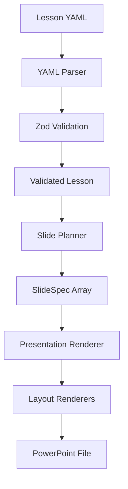

# Arabic Deck Builder

A local, structured PowerPoint generation system for teaching Arabic as a foreign language.

Arabic Deck Builder transforms teacher-authored lesson specifications into validated, structured PowerPoint presentations. The project is designed around two complementary goals:

1. applying software engineering principles to educational content generation;
2. supporting a pedagogically controlled workflow for teaching Arabic to non-native speakers, especially beginner learners.

The project does **not** use AI to invent lesson content. The teacher remains responsible for learning objectives, vocabulary, questions, sequencing, and instructional decisions. The software converts this structured lesson design into presentation-ready slide specifications and PowerPoint files.

---

## Why I Built This Project

While teaching Arabic to foreign learners, I found that preparing high-quality lessons required repeatedly performing the same technical work:

- creating slides;
- maintaining visual consistency;
- duplicating question and answer states;
- organizing lesson progression;
- placing Arabic and translation support correctly;
- recreating similar activity structures across lessons.

The difficult part should be **teaching design**, not repetitive slide construction.

This project explores how software engineering can separate these two concerns:

> The teacher designs the learning experience.  
> The system handles deterministic presentation generation.

This distinction is especially important in language education, where the order in which information appears can be part of the pedagogy itself.

For example, a learner may first see a question:

**مَا هَذَا؟**

and only after attempting an answer should the system reveal:

**هَذَا كِتَاب**

Instead of manually creating and maintaining both slides, the teacher can describe one instructional activity and allow the program to generate the required presentation states.

---

## Current Status

**Current release: `v0.1.0`**

The first milestone implements the complete core pipeline:

```text
Lesson YAML
    ↓
YAML Parser
    ↓
Zod Validation
    ↓
Validated Lesson
    ↓
Slide Planner
    ↓
SlideSpec[]
    ↓
Presentation Renderer
    ↓
PowerPoint (.pptx)
```

The current version supports a small initial activity model while the architecture is being developed incrementally.

### Implemented

- human-readable lesson files using YAML;
- runtime lesson validation using Zod;
- TypeScript-based lesson and slide models;
- deterministic activity-to-slide planning;
- multiple generated slide states from one learning activity;
- PowerPoint generation using PptxGenJS;
- separate presentation theme configuration;
- separate slide layout renderers;
- Arabic right-to-left text support;
- Russian learner-support text;
- modular project architecture;
- local generation without requiring a cloud API.

### Current activity types

- `introduce`
- `question_reveal`

A `question_reveal` activity is automatically expanded into two presentation states:

```text
question_reveal
      ↓
 ┌──────────┐
 │ question │
 └──────────┘
      +
 ┌──────────┐
 │  reveal  │
 └──────────┘
```

---

## Example Lesson

A lesson is written as structured YAML:

```yaml
id: A0-L02
level: A0
title: هَذَا وهَذِهِ
goal: يشير الطالب إلى الأشياء والأشخاص ويسأل ويجيب باستخدام ما ومن وهذا وهذه

activities:
  - type: introduce
    arabic: هَذَا
    russian: это / этот

  - type: introduce
    arabic: هَذِهِ
    russian: это / эта

  - type: question_reveal
    question: مَا هَذَا؟
    answer: هَذَا كِتَاب
    image: book
```

The program validates the lesson before any presentation is generated.

If a field has the wrong type, such as:

```yaml
id: 55
```

instead of:

```yaml
id: A0-L02
```

the validation layer rejects the lesson before it reaches the presentation system.

---

## Architecture

The project follows a pipeline architecture in which each layer has one main responsibility.



### Parser

Reads a lesson from disk and converts the YAML text into JavaScript data.

### Validation

Zod validates external lesson data before it is trusted by the rest of the application.

This creates a clear boundary:

```text
External data
    ↓
unknown
    ↓
validation
    ↓
trusted Lesson
```

### Slide Planner

The planner contains presentation-independent instructional logic.

For example:

```text
1 activity
question_reveal
```

becomes:

```text
2 slide specifications
question
reveal
```

The planner does not know anything about PowerPoint coordinates, fonts, colors, or files.

### Presentation Renderer

The renderer receives a `SlideSpec` and dispatches it to the appropriate layout renderer.

```text
SlideSpec
   ↓
renderer
   ├── introduce → introduce layout
   ├── question  → question layout
   └── reveal    → reveal layout
```

### Layouts

Each layout is responsible only for the visual representation of one slide type.

This separation allows instructional logic and visual design to evolve independently.

---

## Project Structure

```text
arabic-deck-builder/
├── assets/
│   ├── fonts/
│   ├── icons/
│   └── images/
│
├── lessons/
│   └── A0-L02.yaml
│
├── output/
│
├── src/
│   ├── index.ts
│   │
│   ├── parser/
│   │   └── lesson.parser.ts
│   │
│   ├── planner/
│   │   └── slide-planner.ts
│   │
│   ├── presentation/
│   │   ├── pptx.ts
│   │   ├── renderer.ts
│   │   ├── render-presentation.ts
│   │   ├── theme.ts
│   │   └── layouts/
│   │       ├── introduce.ts
│   │       ├── question.ts
│   │       └── reveal.ts
│   │
│   ├── schema/
│   │   └── lesson.schema.ts
│   │
│   └── types/
│       └── slide.ts
│
├── package.json
└── tsconfig.json
```

---

## Technology Stack

### TypeScript

Used for the core application and domain models.

TypeScript helps catch structural errors during development and works together with runtime validation to provide two layers of protection.

### Node.js

Provides the local runtime and filesystem access required to read lessons and generate presentation files.

The project is currently developed and tested with:

```text
Node.js 26.12.0
```

### YAML

Used as the lesson-authoring format because it is readable and easy for a teacher to edit without writing application code.

### Zod

Provides runtime validation for lesson files.

Static TypeScript types alone cannot guarantee that an external YAML file contains valid data, so Zod acts as the trust boundary between external lesson content and application logic.

### PptxGenJS

Used to generate PowerPoint presentations programmatically.

The presentation layer is isolated from the lesson-planning layer so that PowerPoint-specific implementation details do not enter the instructional data model.

---

## Engineering Principles

### Separation of concerns

The project separates:

```text
lesson content
instructional logic
presentation design
file generation
```

rather than combining them into one large rendering function.

### Single source of truth

Shared visual properties such as fonts and colors are stored centrally in the presentation theme.

Lesson structure is validated from one schema rather than duplicated across unrelated parts of the application.

### Deterministic generation

The current system is deliberately deterministic.

If the teacher defines:

```yaml
type: question_reveal
```

the program follows known rules for generating the resulting slides.

It does not ask an AI model to decide what the learner should study.

### Small, composable functions

Functions are designed around specific responsibilities such as:

```text
loadLesson()
planSlides()
renderSlide()
renderPresentation()
```

This makes the system easier to test, maintain, and extend.

### External-library isolation

PowerPoint-library integration is kept inside the presentation layer.

This reduces coupling between domain logic and third-party implementation details.

---

## Pedagogical Design

The software architecture is influenced directly by language-teaching methodology.

The system is being designed to support patterns such as:

### Attempt before reveal

Learners should have an opportunity to retrieve an answer before seeing it.

```text
Question
   ↓
Learner attempt
   ↓
Answer reveal
```

### Progressive support reduction

Future activity types will allow a lesson to gradually reduce translation or visual support as learner independence increases.

### Dialogue construction

Instead of presenting a complete dialogue immediately, future lesson activities will be able to build conversations incrementally.

### Recycling

Previously learned language can be reused in new contexts rather than introduced once and abandoned.

### Teacher-controlled content

The software does not replace instructional judgment.

The teacher determines:

- learning objectives;
- productive vocabulary;
- receptive vocabulary;
- activity order;
- prompts;
- answers;
- repetition;
- learner support.

The system is responsible for transforming these decisions into presentation states.

---

## Why This Is Both a Software and Educational Project

Arabic Deck Builder is not only an automation project.

It is an attempt to model an educational workflow as a software system.

From a software engineering perspective, the project explores:

- typed domain modelling;
- parsing and validation;
- modular architecture;
- deterministic transformation pipelines;
- abstraction boundaries;
- third-party library integration;
- extensibility;
- version control and semantic versioning.

From an educational perspective, it explores:

- controlled language progression;
- retrieval before answer exposure;
- scaffolding;
- support fading;
- vocabulary recycling;
- visual learning materials;
- separation between productive and receptive knowledge;
- teacher-controlled instructional sequencing.

The project therefore sits at the intersection of:

**Software Engineering × Educational Technology × Arabic Language Teaching**

---

## Running the Project

Install dependencies:

```bash
npm install
```

Check TypeScript:

```bash
npm run typecheck
```

Generate the current lesson presentation:

```bash
npm run dev
```

The generated presentation is written to the `output/` directory.

---

## Development Roadmap

### `v0.1.0` — Core Pipeline

- YAML lesson format
- parsing
- runtime validation
- slide planning
- PowerPoint generation
- initial layouts

**Status: completed**

### `v0.2.0` — Asset System

Planned:

- real lesson images;
- logical asset names;
- asset path resolution;
- missing-asset validation;
- image placement and scaling.

### `v0.3.0` — Teaching Activities

Planned activity models include:

- dialogue building;
- support fading;
- independent recall;
- additional question patterns.

### `v0.4.0` — Presentation Design System

Planned:

- reusable typography scales;
- spacing system;
- visual hierarchy;
- richer reusable layouts;
- improved consistency across lessons.

### `v0.5.0` — Educational SVG Visuals

Planned deterministic graphics for elements where generative images are unsuitable, including:

- clocks;
- numbers;
- quantities;
- directions;
- diagrams.

### Later Development

Possible later additions include:

- automated testing;
- command-line lesson generation;
- presentation quality checks;
- local scene-image generation;
- additional lesson schemas;
- larger curriculum support.

---

## Design Philosophy

The long-term goal is not:

> “Generate a lesson automatically.”

The goal is:

> **Give the teacher a structured language for describing a lesson, then let software handle the repetitive production work.**

This preserves pedagogical control while applying software engineering to the parts of lesson preparation that can be made systematic and reusable.

---

## Author

Developed as an independent software engineering and educational technology project focused on Arabic-language instruction for non-native learners.

The project is being developed incrementally through real teaching requirements rather than as a purely theoretical prototype.

---

## License

MIT
